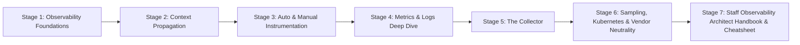
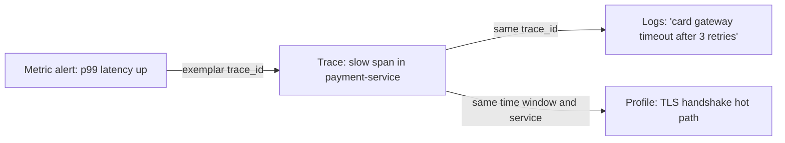
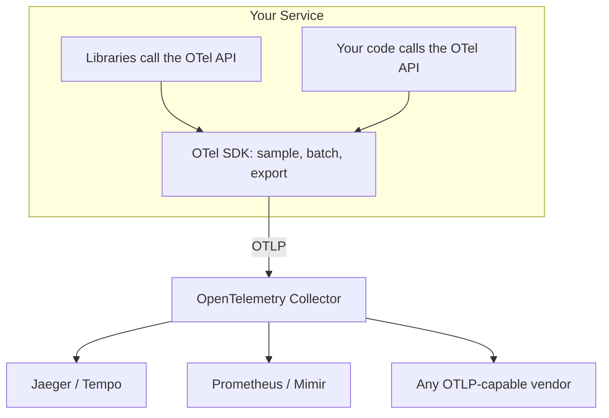
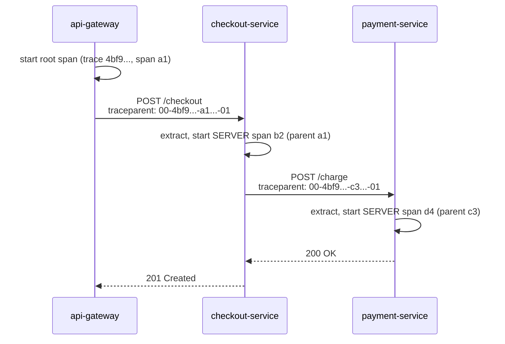
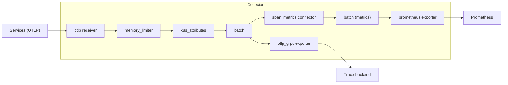
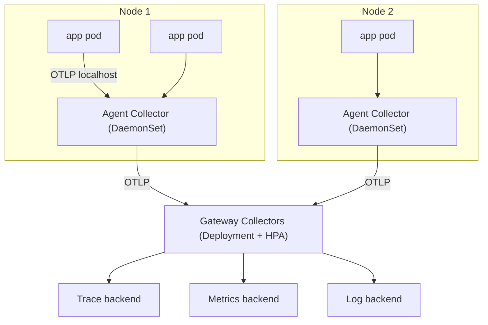
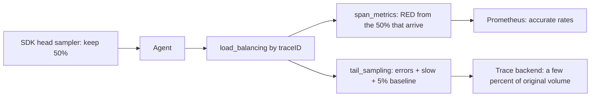

# Learn OpenTelemetry 🔭

<div align="center">

[](https://opensource.org/licenses/MIT)
[](https://opentelemetry.io/)
[](https://opentelemetry.io/docs/specs/otlp/)
[](https://nodejs.org/)
[](https://www.jaegertracing.io/)
[](https://github.com/TheLearningHubOrg/learn-opentelemetry)

**An exhaustive, production-grade masterclass from absolute zero to staff-level OpenTelemetry and vendor-neutral observability architecture.**  
Master traces, metrics and logs, context propagation, auto and manual instrumentation, semantic conventions, the OpenTelemetry Collector, tail sampling, and backend-agnostic telemetry pipelines.

[Getting Started](#1-stage-1-absolute-beginner-foundations--observability-primer) • [Context Propagation](#2-stage-2-context-propagation--distributed-tracing) • [Instrumentation](#3-stage-3-auto--manual-instrumentation-mastery) • [Metrics & Logs](#4-stage-4-metrics--logs-deep-dive) • [The Collector](#5-stage-5-the-opentelemetry-collector-deep-dive) • [Production Operations](#6-stage-6-production-operations-sampling--vendor-neutral-observability) • [Staff Handbook](#7-stage-7-staff-observability-architect-interview-handbook--cheatsheet)

<br/>

<a href="https://www.buymeacoffee.com/manthanank">
  
</a>

</div>

---

## 🗺️ 7-Stage Pedagogical Roadmap



| Stage | Domain Focus | Core Concepts & Production Outcomes |
| :--- | :--- | :--- |
| **Stage 1** | **Observability Foundations & Signal Model** | Monitoring vs observability, traces, metrics, logs and profiles, the API/SDK split, `OTLP`, spans, `SpanContext`, attributes, events, status. |
| **Stage 2** | **Context Propagation & Distributed Tracing** | `AsyncLocalStorage` context, W3C `traceparent` and `tracestate`, `baggage`, inject/extract across queues, span kinds, span links. |
| **Stage 3** | **Auto & Manual Instrumentation** | `NodeSDK` bootstrap, ESM loader hooks, `startActiveSpan`, error recording, semantic conventions, Python and Java agents, Kubernetes Operator injection. |
| **Stage 4** | **Metrics & Logs Deep Dive** | Counters, histograms, gauges, observable instruments, temporality, Views, cardinality limits, exponential histograms, log correlation, exemplars. |
| **Stage 5** | **The OpenTelemetry Collector** | Receivers, processors, exporters, connectors, agent vs gateway topologies, `tail_sampling`, `load_balancing`, `span_metrics`, OTTL redaction. |
| **Stage 6** | **Production Operations & Vendor Neutrality** | Head vs tail sampling economics, Helm and Operator deployments, persistent queues, Collector self-monitoring, backend swaps with zero code changes. |
| **Stage 7** | **Staff Observability Architect Handbook** | 40 staff-level scenario Q&As, failure modes, debugging playbooks, and an enterprise configuration cheatsheet. |

---

## 📋 Table of Contents
- [1. Stage 1: Absolute Beginner Foundations & Observability Primer](#1-stage-1-absolute-beginner-foundations--observability-primer)
  - [1.1 Monitoring vs Observability](#11-monitoring-vs-observability)
  - [1.2 The Signals: Traces, Metrics, Logs & Profiles](#12-the-signals-traces-metrics-logs--profiles)
  - [1.3 What OpenTelemetry Is (and Is Not)](#13-what-opentelemetry-is-and-is-not)
  - [1.4 Anatomy of a Trace & Span](#14-anatomy-of-a-trace--span)
  - [1.5 Your First Traced Script](#15-your-first-traced-script)
- [2. Stage 2: Context Propagation & Distributed Tracing](#2-stage-2-context-propagation--distributed-tracing)
  - [2.1 Context & the Active Span](#21-context--the-active-span)
  - [2.2 W3C Trace Context: traceparent & tracestate](#22-w3c-trace-context-traceparent--tracestate)
  - [2.3 Baggage: Cross-Service Key-Value Context](#23-baggage-cross-service-key-value-context)
  - [2.4 Propagating Through Message Queues](#24-propagating-through-message-queues)
  - [2.5 Span Kinds & Span Links](#25-span-kinds--span-links)
- [3. Stage 3: Auto & Manual Instrumentation Mastery](#3-stage-3-auto--manual-instrumentation-mastery)
  - [3.1 Zero-Code Auto-Instrumentation](#31-zero-code-auto-instrumentation)
  - [3.2 Bootstrapping the Node.js SDK](#32-bootstrapping-the-nodejs-sdk)
  - [3.3 Manual Spans, Attributes & Error Handling](#33-manual-spans-attributes--error-handling)
  - [3.4 Semantic Conventions & Attribute Hygiene](#34-semantic-conventions--attribute-hygiene)
  - [3.5 Instrumenting Python & Polyglot Services](#35-instrumenting-python--polyglot-services)
  - [3.6 Kubernetes Operator Auto-Injection](#36-kubernetes-operator-auto-injection)
- [4. Stage 4: Metrics & Logs Deep Dive](#4-stage-4-metrics--logs-deep-dive)
  - [4.1 Instruments: Counters, Histograms, Gauges & Observables](#41-instruments-counters-histograms-gauges--observables)
  - [4.2 Aggregation Temporality: Cumulative vs Delta](#42-aggregation-temporality-cumulative-vs-delta)
  - [4.3 Views, Cardinality & Exponential Histograms](#43-views-cardinality--exponential-histograms)
  - [4.4 Logs Bridge & Trace Correlation](#44-logs-bridge--trace-correlation)
  - [4.5 Exemplars: Jumping from Metrics to Traces](#45-exemplars-jumping-from-metrics-to-traces)
- [5. Stage 5: The OpenTelemetry Collector Deep Dive](#5-stage-5-the-opentelemetry-collector-deep-dive)
  - [5.1 Collector Architecture: Receivers, Processors, Exporters & Connectors](#51-collector-architecture-receivers-processors-exporters--connectors)
  - [5.2 A Production Collector Configuration](#52-a-production-collector-configuration)
  - [5.3 Deployment Topologies: Agent vs Gateway](#53-deployment-topologies-agent-vs-gateway)
  - [5.4 Tail-Based Sampling at Scale](#54-tail-based-sampling-at-scale)
  - [5.5 Connectors: Deriving RED Metrics from Spans](#55-connectors-deriving-red-metrics-from-spans)
  - [5.6 OTTL: Transforming Telemetry in Flight](#56-ottl-transforming-telemetry-in-flight)
- [6. Stage 6: Production Operations, Sampling & Vendor-Neutral Observability](#6-stage-6-production-operations-sampling--vendor-neutral-observability)
  - [6.1 Sampling Strategy & Cost Economics](#61-sampling-strategy--cost-economics)
  - [6.2 Running the Companion Stack](#62-running-the-companion-stack)
  - [6.3 Kubernetes Deployment with Helm](#63-kubernetes-deployment-with-helm)
  - [6.4 Vendor Neutrality: Switching Backends by Config](#64-vendor-neutrality-switching-backends-by-config)
  - [6.5 Collector Self-Monitoring & Performance Overhead](#65-collector-self-monitoring--performance-overhead)
  - [6.6 Testing Your Instrumentation](#66-testing-your-instrumentation)
- [7. Stage 7: Staff Observability Architect Interview Handbook & Cheatsheet](#7-stage-7-staff-observability-architect-interview-handbook--cheatsheet)
  - [7.1 Enterprise Production Cheatsheet](#71-enterprise-production-cheatsheet)
  - [7.2 Staff & Principal Architect Interview Q&A (40 Scenarios)](#72-staff--principal-architect-interview-qa-40-scenarios)
- [🤝 Contributing](#-contributing)
- [📄 License](#-license)

---

## 1. Stage 1: Absolute Beginner Foundations & Observability Primer

### 1.1 Monitoring vs Observability

Monitoring answers questions you already knew to ask: "is CPU above 80%?", "is the error rate above 1%?". You write the check in advance and an alert fires when it trips. That works well for failure modes you have seen before.

Observability is the ability to answer questions you did **not** predict, using only the data the system already emits. When a checkout request is slow for one tenant in one region on one app version, a dashboard of averages will not tell you why. You need high-dimensional data that lets you slice by any attribute after the fact.

```
  Monitoring                                Observability
  ----------                                -------------
  "Is the error rate above 1%?"            "Why are EU tenants on v2.3 slow
  Known questions, fixed dashboards          only when paying by card?"
  Aggregates (averages, totals)             Raw events with rich context
  Tells you THAT something broke            Helps you find WHY and WHERE
```

The practical consequence: an observable system emits **structured, correlated telemetry** where every piece of data carries enough context (service, version, route, tenant, trace id) to be joined with every other piece.

### 1.2 The Signals: Traces, Metrics, Logs & Profiles

OpenTelemetry models telemetry as a small set of **signals**. Each one answers a different kind of question, and the real power comes from linking them.

| Signal | What It Captures | Best For | Typical Backend |
| :--- | :--- | :--- | :--- |
| **Traces** | The path of one request through many services, as a tree of timed spans | Latency breakdowns, dependency mapping, finding the slow hop | Jaeger, Tempo, Zipkin, vendor APMs |
| **Metrics** | Numeric measurements aggregated over time | Alerting, SLOs, capacity planning, trends | Prometheus, Mimir, vendor TSDBs |
| **Logs** | Timestamped records, ideally structured | Detailed event context, audit trails, errors | Loki, Elasticsearch/OpenSearch, vendor log stores |
| **Profiles** | Where CPU time and memory go, down to the function | Hot-path optimisation, memory leaks | Pyroscope, Parca, vendor profilers |

Traces and metrics are the most mature signals across every SDK. Logs have a stable data model and are well supported in the major languages. Profiles are the newest signal and are still maturing, so check your language SDK before depending on them.



### 1.3 What OpenTelemetry Is (and Is Not)

OpenTelemetry (OTel) is a CNCF project that standardises **how telemetry is produced and transported**. It came out of the 2019 merger of OpenTracing and OpenCensus, and it is now the default instrumentation layer for most cloud-native stacks.

It is made of several independent pieces:

1. **Specification:** the language-neutral rules every implementation follows (data model, API behaviour, SDK behaviour, environment variables).
2. **API:** lightweight interfaces (`trace`, `metrics`, `propagation`, `context`) that libraries depend on. With no SDK installed the API is a no-op, so library authors can instrument safely.
3. **SDK:** the implementation an **application** installs. It handles sampling, batching, resource detection and exporting.
4. **Semantic Conventions:** agreed names for attributes and metrics (`http.request.method`, `db.system.name`, `http.server.request.duration`) so every tool understands the data the same way.
5. **OTLP:** the OpenTelemetry Protocol, a protobuf wire format sent over gRPC (port `4317`) or HTTP (port `4318`).
6. **Collector:** a standalone, vendor-neutral process that receives, processes and exports telemetry.
7. **Instrumentation libraries and agents:** ready-made hooks for HTTP servers, database drivers, message clients and more.

What OTel is **not**: it is not a backend. It does not store data, draw dashboards or fire alerts. You still pick Jaeger, Prometheus, Grafana, Elastic or a commercial vendor for that. OTel's promise is that you can change that choice without re-instrumenting your code.



### 1.4 Anatomy of a Trace & Span

A **trace** is the full story of one operation, such as a single HTTP request. It is a tree of **spans**, where each span is one timed unit of work.

```
Trace 4bf92f3577b34da6a3ce929d0e0e4736
|
+-- POST /checkout                (SERVER, api-gateway)        0ms ----------- 180ms
    +-- checkout                  (INTERNAL, checkout-svc)      5ms --------- 170ms
        +-- SELECT orders         (CLIENT, postgres)            8ms -- 30ms
        +-- POST /charge          (CLIENT -> payment-svc)      35ms ------- 160ms
            +-- charge_card       (SERVER, payment-svc)        38ms ------ 158ms
```

Every span carries:

1. **Name:** a low-cardinality operation name (`POST /checkout`, not `POST /checkout?id=91`).
2. **SpanContext:** the `trace_id` (16 bytes), the `span_id` (8 bytes), trace flags (for example "sampled") and `tracestate`. This is the part that propagates between services.
3. **Parent span id:** links the span into the tree. A span with no parent is the **root span**.
4. **Kind:** `SERVER`, `CLIENT`, `PRODUCER`, `CONSUMER` or `INTERNAL`.
5. **Start and end timestamps.**
6. **Attributes:** typed key-value pairs (`http.response.status_code=200`).
7. **Events:** timestamped annotations inside the span, such as an exception or a cache miss.
8. **Links:** references to spans in *other* traces (covered in 2.5).
9. **Status:** `Unset` (default), `Ok` or `Error`. Instrumentation sets `Error` on failure and leaves `Unset` on success, so `Ok` stays available for an application that wants to override a failure explicitly.

Every signal is also tagged with a **Resource**: attributes that describe the entity producing the telemetry (`service.name`, `service.version`, `deployment.environment.name`, `k8s.pod.name`, `host.name`). `service.name` is the single most important attribute in OpenTelemetry. Without it, most backends show your data as `unknown_service`.

### 1.5 Your First Traced Script

Start with the smallest possible setup: one provider, one console exporter, two spans. This runs with plain Node.js and prints spans to the terminal.

```bash
# 1. Create a scratch project
mkdir otel-hello && cd otel-hello
npm init -y
npm pkg set type=module

# 2. Install the API plus a minimal SDK
npm install @opentelemetry/api @opentelemetry/sdk-trace-node @opentelemetry/resources @opentelemetry/semantic-conventions
```

```javascript
// hello.mjs: print two nested spans to the console
import { trace } from '@opentelemetry/api';
import { resourceFromAttributes } from '@opentelemetry/resources';
import { ATTR_SERVICE_NAME } from '@opentelemetry/semantic-conventions';
import {
  ConsoleSpanExporter,
  NodeTracerProvider,
  SimpleSpanProcessor,
} from '@opentelemetry/sdk-trace-node';

// 1. Configure the SDK once, at process start
const provider = new NodeTracerProvider({
  resource: resourceFromAttributes({ [ATTR_SERVICE_NAME]: 'hello-otel' }),
  spanProcessors: [new SimpleSpanProcessor(new ConsoleSpanExporter())],
});
provider.register(); // installs the global provider, context manager and propagators

// 2. Use only the API in application code
const tracer = trace.getTracer('hello-otel', '1.0.0');

await tracer.startActiveSpan('make-breakfast', async (parent) => {
  await tracer.startActiveSpan('brew-coffee', async (child) => {
    child.setAttribute('coffee.strength', 'strong');
    await new Promise((r) => setTimeout(r, 50));
    child.end();
  });
  parent.addEvent('toast.burned', { 'toast.slices': 2 });
  parent.end();
});

// 3. Flush before exit
await provider.shutdown();
```

Run it with `node hello.mjs`. You will see two span objects. Both share one `traceId`, and the child's `parentSpanContext.spanId` matches the parent's `id`. That shared id is the entire mechanism behind distributed tracing.

> **Rule of thumb:** application code and libraries talk to the **API** only. The **SDK** is configured exactly once, at the edge of the process. That split is what lets a library ship instrumentation without forcing an exporter choice on its users.

---

## 2. Stage 2: Context Propagation & Distributed Tracing

### 2.1 Context & the Active Span

**Context** is an immutable key-value bag that travels with a unit of work. The active span lives in it, and so does baggage. In Node.js the SDK stores context in `AsyncLocalStorage`, so it follows a request across `await`, timers and callbacks without you passing it by hand.

```typescript
import { context, trace } from '@opentelemetry/api';

const tracer = trace.getTracer('context-demo');

// startActiveSpan makes the new span "current" for everything inside the callback
await tracer.startActiveSpan('handle-request', async (span) => {
  await doDatabaseWork();               // any span created in here becomes a child
  console.log(trace.getActiveSpan() === span); // true
  span.end();
});

// startSpan creates a span but does NOT make it active
const detached = tracer.startSpan('background-job');
// Activate it explicitly for a block of code:
await context.with(trace.setSpan(context.active(), detached), async () => {
  await doDatabaseWork();               // child of background-job
});
detached.end();
```

Context loss is the most common tracing bug. It happens when work escapes the async chain: a hand-rolled connection pool, an event emitter created before the request, or a callback queue in a native addon. The symptom is a trace split into several disconnected root spans. The fix is `context.bind(context.active(), fn)` at the point where the callback is registered.

### 2.2 W3C Trace Context: traceparent & tracestate

To continue a trace in another process, the `SpanContext` has to cross the wire. OpenTelemetry uses the W3C Trace Context standard by default. It defines two HTTP headers:

```
traceparent: 00-4bf92f3577b34da6a3ce929d0e0e4736-00f067aa0ba902b7-01
             |  |                                |                |
             |  trace-id (32 hex chars)          parent-id        trace-flags
             version                             (16 hex chars)   01 = sampled

tracestate:  congo=t61rcWkgMzE,rojo=00f067aa0ba902b7
             vendor-specific key=value pairs, carried through untouched
```



The two halves of propagation are **inject** (write context into an outgoing carrier) and **extract** (read it from an incoming carrier). HTTP and gRPC instrumentation does both for you. You only call them yourself for transports that have no instrumentation.

Propagators are configured globally. The default is W3C Trace Context plus W3C Baggage. Set `OTEL_PROPAGATORS=tracecontext,baggage,b3multi` when you need to interoperate with older Zipkin-style systems that send B3 headers.

### 2.3 Baggage: Cross-Service Key-Value Context

**Baggage** carries application-defined key-value pairs alongside the trace, in a `baggage` header. A typical use is setting `tenant.id` at the edge so every downstream service can read it without each API having to accept it as a parameter.

```typescript
import { context, propagation, trace } from '@opentelemetry/api';

// 1. At the edge: attach baggage to the current context
const bag = propagation.createBaggage({
  'tenant.id': { value: 'acme-corp' },
  'feature.flag': { value: 'new-pricing' },
});

await context.with(propagation.setBaggage(context.active(), bag), async () => {
  await fetch('http://checkout/checkout', { method: 'POST' }); // header sent automatically
});

// 2. Downstream: read baggage and copy what you need onto the span
const tenant = propagation.getActiveBaggage()?.getEntry('tenant.id')?.value;
if (tenant) trace.getActiveSpan()?.setAttribute('tenant.id', tenant);
```

Three rules for baggage in production:

1. **Baggage is not telemetry.** Its entries are not added to spans automatically. Copy them explicitly, or use a span processor that does so for an allowlist of keys.
2. **Baggage leaks.** It goes to every downstream call, including third-party APIs. Never put credentials, emails or anything sensitive in it, and strip it at your egress proxy.
3. **Baggage costs bytes on every hop.** Keep it to a few short keys.

### 2.4 Propagating Through Message Queues

Asynchronous systems break the request/response model, so the trace context has to travel *inside the message*. Put it in the message headers, never in the payload body. That keeps the business schema clean.

```typescript
// Producer and consumer with manual inject/extract over message headers
import { context, propagation, SpanKind, trace } from '@opentelemetry/api';

const tracer = trace.getTracer('orders-queue');

interface Message { body: string; headers: Record<string, string> }

// 1. Producer: create a PRODUCER span and inject its context into the headers
export function publish(queue: Message[], body: string): void {
  tracer.startActiveSpan('orders publish', { kind: SpanKind.PRODUCER }, (span) => {
    const headers: Record<string, string> = {};
    propagation.inject(context.active(), headers); // writes traceparent (+ baggage)
    queue.push({ body, headers });
    span.end();
  });
}

// 2. Consumer: extract the remote context and start a CONSUMER span under it
export function consume(message: Message): void {
  const parentCtx = propagation.extract(context.active(), message.headers);
  tracer.startActiveSpan(
    'orders process',
    { kind: SpanKind.CONSUMER, attributes: { 'messaging.system': 'custom' } },
    parentCtx,
    (span) => {
      // business logic: any span created here joins the producer's trace
      span.end();
    },
  );
}
```

Kafka, RabbitMQ, SQS and NATS clients all have instrumentation packages that do exactly this. Use the hand-written version above only for in-house transports.

### 2.5 Span Kinds & Span Links

**Span kind** tells the backend how to draw the relationship between services:

| Kind | Meaning | Example |
| :--- | :--- | :--- |
| `SERVER` | Handles an incoming synchronous request | Express or Fastify route handler |
| `CLIENT` | Makes an outgoing synchronous request | `fetch`, a SQL query, a gRPC call |
| `PRODUCER` | Hands a message to a broker | Kafka `send` |
| `CONSUMER` | Receives a message from a broker | Kafka poll loop handler |
| `INTERNAL` | In-process work with no remote side | Pricing calculation |

Service maps are built from `CLIENT` to `SERVER` and `PRODUCER` to `CONSUMER` pairs, so the wrong kind produces a broken map.

**Span links** connect a span to spans in *other* traces when a parent-child relationship would be misleading. The classic case is a batch consumer that processes 100 messages from 100 different producers in one go:

```typescript
import { context, propagation, trace, type Link, type SpanContext } from '@opentelemetry/api';

const tracer = trace.getTracer('batch-worker');

export function processBatch(messages: { headers: Record<string, string> }[]): void {
  // One link per message, each pointing at that message's producer span
  const links: Link[] = messages
    .map((m) => trace.getSpanContext(propagation.extract(context.active(), m.headers)))
    .filter((ctx): ctx is SpanContext => ctx !== undefined)
    .map((ctx) => ({ context: ctx }));

  tracer.startActiveSpan('orders process-batch', { links }, (span) => {
    span.setAttribute('messaging.batch.message_count', messages.length);
    span.end();
  });
}
```

---

## 3. Stage 3: Auto & Manual Instrumentation Mastery

### 3.1 Zero-Code Auto-Instrumentation

Auto-instrumentation patches popular libraries at load time so you get HTTP, database and messaging spans without changing application code. Every major language has a variant:

```bash
# Node.js (CommonJS app): preload the register module
npm install @opentelemetry/api @opentelemetry/auto-instrumentations-node
export OTEL_SERVICE_NAME=checkout-service
export OTEL_EXPORTER_OTLP_ENDPOINT=http://localhost:4318
export OTEL_TRACES_EXPORTER=otlp
export OTEL_NODE_RESOURCE_DETECTORS=env,host,os,process
node --require @opentelemetry/auto-instrumentations-node/register app.js

# Java: attach the agent jar, no code or rebuild needed
java -javaagent:./opentelemetry-javaagent.jar \
     -Dotel.service.name=billing-service \
     -Dotel.exporter.otlp.endpoint=http://localhost:4318 \
     -jar billing.jar

# Python: install the distro, let bootstrap add matching instrumentations, then wrap the process
pip install opentelemetry-distro opentelemetry-exporter-otlp
opentelemetry-bootstrap -a install
OTEL_SERVICE_NAME=catalog-service opentelemetry-instrument uvicorn main:app --port 8000
```

All of these read the same standard environment variables, which is a large part of OpenTelemetry's portability:

| Variable | Purpose | Example |
| :--- | :--- | :--- |
| `OTEL_SERVICE_NAME` | Sets `service.name` | `checkout-service` |
| `OTEL_RESOURCE_ATTRIBUTES` | Extra resource attributes | `service.version=2.3.1,deployment.environment.name=prod` |
| `OTEL_EXPORTER_OTLP_ENDPOINT` | Base OTLP endpoint | `http://otel-collector:4318` |
| `OTEL_EXPORTER_OTLP_PROTOCOL` | Wire protocol | `http/protobuf`, `grpc`, `http/json` |
| `OTEL_TRACES_SAMPLER` / `_ARG` | Head sampler and its argument | `parentbased_traceidratio` / `0.1` |
| `OTEL_PROPAGATORS` | Propagation formats | `tracecontext,baggage` |
| `OTEL_METRIC_EXPORT_INTERVAL` | Metric push interval in ms | `15000` |
| `OTEL_SDK_DISABLED` | Kill switch for the whole SDK | `true` |

Auto-instrumentation covers the edges of your service (inbound HTTP, outbound HTTP, SQL, Redis, Kafka). It cannot know your **business operations**. That is what manual instrumentation is for, and production systems use both.

### 3.2 Bootstrapping the Node.js SDK

For full control, configure `NodeSDK` in code. The companion project in this repository does it in `src/telemetry.ts`. The essentials:

```typescript
// src/telemetry.ts (abridged): one SDK, three signals, all over OTLP/HTTP
import { getNodeAutoInstrumentations } from '@opentelemetry/auto-instrumentations-node';
import { OTLPLogExporter } from '@opentelemetry/exporter-logs-otlp-http';
import { OTLPMetricExporter } from '@opentelemetry/exporter-metrics-otlp-http';
import { OTLPTraceExporter } from '@opentelemetry/exporter-trace-otlp-http';
import { defaultResource, resourceFromAttributes } from '@opentelemetry/resources';
import { BatchLogRecordProcessor } from '@opentelemetry/sdk-logs';
import { PeriodicExportingMetricReader } from '@opentelemetry/sdk-metrics';
import { NodeSDK } from '@opentelemetry/sdk-node';
import { BatchSpanProcessor, ParentBasedSampler, TraceIdRatioBasedSampler } from '@opentelemetry/sdk-trace-node';
import { ATTR_SERVICE_NAME, ATTR_SERVICE_VERSION } from '@opentelemetry/semantic-conventions';

const endpoint = process.env.OTEL_EXPORTER_OTLP_ENDPOINT ?? 'http://localhost:4318';

export const sdk = new NodeSDK({
  // 1. Who is emitting: merged with host/process attributes the SDK detects
  resource: defaultResource().merge(
    resourceFromAttributes({
      [ATTR_SERVICE_NAME]: 'checkout-service',
      [ATTR_SERVICE_VERSION]: '1.0.0',
      'deployment.environment.name': 'local',
    }),
  ),
  // 2. Head sampling: follow the caller's decision, else keep 25% of new traces
  sampler: new ParentBasedSampler({ root: new TraceIdRatioBasedSampler(0.25) }),
  // 3. Batch everything: never use SimpleSpanProcessor in production
  spanProcessors: [new BatchSpanProcessor(new OTLPTraceExporter({ url: `${endpoint}/v1/traces` }))],
  metricReaders: [
    new PeriodicExportingMetricReader({
      exporter: new OTLPMetricExporter({ url: `${endpoint}/v1/metrics` }),
      exportIntervalMillis: 15_000,
    }),
  ],
  logRecordProcessors: [
    new BatchLogRecordProcessor({ exporter: new OTLPLogExporter({ url: `${endpoint}/v1/logs` }) }),
  ],
  // 4. Library patching, minus the noisy fs instrumentation
  instrumentations: [getNodeAutoInstrumentations({ '@opentelemetry/instrumentation-fs': { enabled: false } })],
});

sdk.start();
process.once('SIGTERM', () => void sdk.shutdown().finally(() => process.exit(0)));
```

**The load-order rule.** Instrumentation works by intercepting `require`/`import` of a library. If `express` or `pg` is loaded before the SDK starts, it is never patched and you get no spans. For an ES module application, also register the loader hook before starting the SDK and preload the file with `--import`:

```typescript
// src/instrumentation.ts: preloaded with `node --import ./dist/instrumentation.js dist/index.js`
import { register } from 'node:module';
import { startTelemetry } from './telemetry.js';

register('@opentelemetry/instrumentation/hook.mjs', import.meta.url); // patch ESM imports
startTelemetry();                                                      // then start the SDK
```

### 3.3 Manual Spans, Attributes & Error Handling

Manual spans wrap the operations that matter to the business. Follow one pattern every time: start the span active, `try` the work, record failures, and `end()` in `finally`.

```typescript
// From src/orders.ts: a business span with children, an event, an error path and a metric
import { metrics, SpanStatusCode, trace, type Span } from '@opentelemetry/api';

const tracer = trace.getTracer('learn-opentelemetry.orders', '1.0.0');
const ordersPlaced = metrics.getMeter('learn-opentelemetry.orders').createCounter('orders.placed');

export async function checkout(order: OrderRequest): Promise<OrderReceipt> {
  return tracer.startActiveSpan('checkout', { attributes: { 'customer.id': order.customerId } }, async (span: Span) => {
    try {
      validate(order);                              // throws ValidationError
      const total = await priceOrder(order);        // child span "price_order"
      await reserveInventory(order);                // child span with "inventory.reserved" events
      ordersPlaced.add(1, { 'checkout.result': 'success' });
      return { orderId: `ord_${span.spanContext().spanId}`, total, traceId: span.spanContext().traceId };
    } catch (err) {
      const error = err instanceof Error ? err : new Error(String(err));
      span.recordException(error);                  // adds an "exception" event with type, message, stack
      span.setStatus({ code: SpanStatusCode.ERROR, message: error.message });
      ordersPlaced.add(1, { 'checkout.result': 'failure', 'error.type': error.name });
      throw error;
    } finally {
      span.end();                                   // a span that never ends is never exported
    }
  });
}
```

Practical guidance for manual spans:

1. **Name spans by operation, not by instance.** `checkout` is good. `checkout order 8812` creates unbounded cardinality in every backend that groups by name.
2. **Prefer attributes over events** for data you want to filter on. Use events for "something happened at this moment" within a span.
3. **Do not over-instrument.** A span per function call adds overhead and noise. One span per meaningful unit of work (an external call, a business step, a retry loop) is usually right.
4. **Use one tracer per module**, named after the instrumentation scope (`learn-opentelemetry.orders`), so you can see which code produced which span.
5. **Always end spans**, including on early returns. A leaked span sits in memory and never reaches the exporter.

### 3.4 Semantic Conventions & Attribute Hygiene

Semantic conventions are what make telemetry from a Go service, a Java service and a Postgres driver line up in one query. Use the published constants rather than hand-typed strings:

```typescript
import {
  ATTR_HTTP_REQUEST_METHOD,
  ATTR_HTTP_RESPONSE_STATUS_CODE,
  ATTR_HTTP_ROUTE,
  ATTR_URL_PATH,
  ATTR_SERVER_ADDRESS,
} from '@opentelemetry/semantic-conventions';

span.setAttributes({
  [ATTR_HTTP_REQUEST_METHOD]: 'POST',
  [ATTR_HTTP_ROUTE]: '/orders/:id',      // the template, never the raw path
  [ATTR_URL_PATH]: '/orders/8812',
  [ATTR_HTTP_RESPONSE_STATUS_CODE]: 201,
  [ATTR_SERVER_ADDRESS]: 'orders.internal',
});
```

| Concern | Do | Avoid |
| :--- | :--- | :--- |
| **Naming** | Standard names (`http.request.method`), then your own namespace (`acme.cart.size`) | Inventing `httpMethod`, `method`, `verb` across teams |
| **Cardinality** | Bounded values (`http.route`, `tenant.tier`) | User ids, raw URLs or UUIDs as **metric** attributes |
| **PII** | Opaque ids, hashed values | Emails, card numbers, auth headers, full request bodies |
| **Stability** | Pin a semconv version and migrate deliberately | Mixing old (`http.method`) and new (`http.request.method`) names silently |

When an instrumentation migrates to newer convention names, `OTEL_SEMCONV_STABILITY_OPT_IN=http/dup` makes it emit both old and new names for a transition period so dashboards can be moved without a gap.

### 3.5 Instrumenting Python & Polyglot Services

A real system mixes languages, and the trace only survives if every service speaks the same propagation format. Here is a Python FastAPI service configured in code. It joins traces started by the Node.js service with no extra work, because both use W3C Trace Context.

```python
# catalog/main.py: FastAPI with explicit SDK setup and one manual span
from fastapi import FastAPI
from opentelemetry import trace
from opentelemetry.exporter.otlp.proto.http.trace_exporter import OTLPSpanExporter
from opentelemetry.instrumentation.fastapi import FastAPIInstrumentor
from opentelemetry.sdk.resources import Resource
from opentelemetry.sdk.trace import TracerProvider
from opentelemetry.sdk.trace.export import BatchSpanProcessor

# 1. SDK setup, once per process
provider = TracerProvider(resource=Resource.create({"service.name": "catalog-service"}))
provider.add_span_processor(
    BatchSpanProcessor(OTLPSpanExporter(endpoint="http://otel-collector:4318/v1/traces"))
)
trace.set_tracer_provider(provider)
tracer = trace.get_tracer("catalog.pricing", "1.0.0")

app = FastAPI()

@app.get("/prices/{sku}")
async def get_price(sku: str) -> dict:
    # 2. The SERVER span comes from FastAPIInstrumentor; this child span is ours
    with tracer.start_as_current_span("lookup_price") as span:
        span.set_attribute("product.sku", sku)
        return {"sku": sku, "price": 12.5}

# 3. Patch the app so every route gets a SERVER span and extracts traceparent
FastAPIInstrumentor.instrument_app(app)
```

```bash
pip install fastapi uvicorn opentelemetry-sdk opentelemetry-exporter-otlp-proto-http opentelemetry-instrumentation-fastapi
uvicorn catalog.main:app --port 8000
```

### 3.6 Kubernetes Operator Auto-Injection

On Kubernetes, the OpenTelemetry Operator can inject auto-instrumentation into pods without touching their images. You declare an `Instrumentation` resource once per namespace, then opt workloads in with an annotation.

```yaml
# 1. Namespace-wide instrumentation policy
apiVersion: opentelemetry.io/v1alpha1
kind: Instrumentation
metadata:
  name: default
  namespace: shop
spec:
  exporter:
    endpoint: http://otel-agent.observability.svc:4318
  propagators: [tracecontext, baggage]
  sampler:
    type: parentbased_traceidratio
    argument: "0.25"
  nodejs:
    env:
      - name: OTEL_EXPORTER_OTLP_PROTOCOL
        value: http/protobuf
---
# 2. Opt a Deployment in: the operator's webhook adds an init container and env vars
apiVersion: apps/v1
kind: Deployment
metadata:
  name: checkout
  namespace: shop
spec:
  selector:
    matchLabels: { app: checkout }
  template:
    metadata:
      labels: { app: checkout }
      annotations:
        instrumentation.opentelemetry.io/inject-nodejs: "true"
    spec:
      containers:
        - name: checkout
          image: registry.example.com/checkout:2.3.1
```

The operator also supports `inject-java`, `inject-python`, `inject-dotnet` and `inject-go`. The Go variant uses eBPF, needs elevated privileges, and also requires the `instrumentation.opentelemetry.io/otel-go-auto-target-exe` annotation naming the binary to attach to. Injection happens at pod creation, so existing pods need a rollout restart to pick it up.

---

## 4. Stage 4: Metrics & Logs Deep Dive

### 4.1 Instruments: Counters, Histograms, Gauges & Observables

A **Meter** creates **instruments**. Pick the instrument by the *shape of the value*, not by how you plan to chart it.

| Instrument | Sync? | Monotonic? | Use It For | Default Aggregation |
| :--- | :--- | :--- | :--- | :--- |
| `Counter` | Yes | Only goes up | Requests served, bytes sent, orders placed | Sum |
| `UpDownCounter` | Yes | Up and down | Items in a queue, active connections | Sum |
| `Histogram` | Yes | n/a | Latency, payload size, order value | Explicit bucket histogram |
| `Gauge` | Yes | n/a | A value you set directly (current temperature) | Last value |
| `ObservableCounter` | Callback | Only goes up | CPU time read from the OS | Sum |
| `ObservableUpDownCounter` | Callback | Up and down | Heap size read on each collection | Sum |
| `ObservableGauge` | Callback | n/a | Pool utilisation, queue lag | Last value |

```typescript
import { metrics, ValueType } from '@opentelemetry/api';

const meter = metrics.getMeter('learn-opentelemetry.inventory', '1.0.0');

// 1. Synchronous instruments: record at the moment something happens
const requests = meter.createCounter('inventory.lookups', { unit: '{lookup}' });
const latency = meter.createHistogram('inventory.lookup.duration', {
  unit: 's',
  valueType: ValueType.DOUBLE,
  advice: { explicitBucketBoundaries: [0.005, 0.01, 0.025, 0.05, 0.1, 0.25, 0.5, 1, 2.5] },
});
const inFlight = meter.createUpDownCounter('inventory.lookups.active', { unit: '{lookup}' });

export async function lookup(sku: string): Promise<number> {
  const start = performance.now();
  inFlight.add(1);
  try {
    requests.add(1, { 'inventory.warehouse': 'eu-west' });
    return await readStock(sku);
  } finally {
    inFlight.add(-1);
    latency.record((performance.now() - start) / 1000, { 'inventory.warehouse': 'eu-west' });
  }
}

// 2. Asynchronous instrument: the SDK calls you once per collection cycle
const poolUsage = meter.createObservableGauge('db.client.connection.usage_ratio', { unit: '1' });
poolUsage.addCallback((result) => {
  result.observe(pool.inUse / pool.max, { 'db.client.connection.pool.name': 'primary' });
});
```

Units follow UCUM: `s` for seconds, `By` for bytes, `1` for ratios, and curly braces for annotations such as `{request}`. Record durations in **seconds** as doubles, which matches the stable HTTP and RPC conventions.

### 4.2 Aggregation Temporality: Cumulative vs Delta

Every exported sum and histogram has a **temporality**:

```
Requests per collection:   5      3      7      2
Cumulative export:         5      8     15     17    (total since process start)
Delta export:              5      3      7      2    (change since last export)
```

1. **Cumulative** is what Prometheus expects. It is robust to dropped exports, because the next point still carries the full total, but the SDK has to keep state for every attribute combination ever seen.
2. **Delta** suits backends that aggregate on ingest and keeps SDK memory flat. A dropped export loses that interval's data.

Set the preference with `OTEL_EXPORTER_OTLP_METRICS_TEMPORALITY_PREFERENCE` (`cumulative`, `delta` or `lowmemory`), and match it to your backend. A mismatch shows up as sawtooth graphs or rates that are far too high or too low.

### 4.3 Views, Cardinality & Exponential Histograms

**Views** let the application owner reshape metrics without touching instrumentation code: rename them, change buckets, drop attributes or drop a metric entirely.

```typescript
import { metrics } from '@opentelemetry/api';
import {
  AggregationType,
  MeterProvider,
  PeriodicExportingMetricReader,
  createAllowListAttributesProcessor,
} from '@opentelemetry/sdk-metrics';
import { OTLPMetricExporter } from '@opentelemetry/exporter-metrics-otlp-http';

const provider = new MeterProvider({
  readers: [new PeriodicExportingMetricReader({ exporter: new OTLPMetricExporter() })],
  views: [
    // 1. High-resolution latency with no hand-tuned buckets
    {
      instrumentName: 'http.server.request.duration',
      aggregation: { type: AggregationType.EXPONENTIAL_HISTOGRAM, options: { maxSize: 160 } },
    },
    // 2. Keep only bounded attributes, cap the series count per metric
    {
      instrumentName: 'inventory.lookups',
      attributesProcessors: [createAllowListAttributesProcessor(['inventory.warehouse'])],
      aggregationCardinalityLimit: 500,
    },
    // 3. Drop a metric a library emits that nobody uses
    { instrumentName: 'nodejs.eventloop.delay.*', aggregation: { type: AggregationType.DROP } },
  ],
});
metrics.setGlobalMeterProvider(provider);
```

**Cardinality** is the number of unique attribute combinations for a metric, and it multiplies. With 20 routes, 8 status codes and 5 regions:

$$20 \times 8 \times 5 = 800 \text{ series}$$

Add `user.id` with 100,000 users and you get 80 million series, which will take down most time-series databases. High-cardinality detail belongs on **spans and logs**. Metrics stay bounded. When the SDK hits a cardinality limit, it folds further combinations into one overflow series marked with `otel.metric.overflow=true` rather than growing without bound.

**Exponential histograms** pick bucket boundaries automatically from a scale factor, so they give good relative accuracy from microseconds to minutes without anyone guessing boundaries up front. Use them where the backend supports them. Prometheus calls the equivalent "native histograms".

### 4.4 Logs Bridge & Trace Correlation

OpenTelemetry does not ask you to replace your logging library. The **Logs Bridge API** is meant for logging library authors: an appender takes records from pino, winston, Log4j, `logging` in Python and so on, and forwards them to the OTel Logs SDK. The SDK stamps each record with the active `trace_id` and `span_id`.

```typescript
// Option A: keep pino and let instrumentation do the bridging
// (@opentelemetry/instrumentation-pino ships inside auto-instrumentations-node)
import pino from 'pino';

const log = pino();
// Inside an active span this record gains trace_id, span_id and trace_flags,
// and is also forwarded to the OTel Logs SDK for export over OTLP.
log.error({ orderId: 'ord_91' }, 'payment declined');
```

```typescript
// Option B: emit directly through the bridge (what src/orders.ts does on failure)
import { logs, SeverityNumber } from '@opentelemetry/api-logs';

const logger = logs.getLogger('learn-opentelemetry.orders', '1.0.0');
logger.emit({
  severityNumber: SeverityNumber.ERROR,
  severityText: 'ERROR',
  body: 'checkout failed: order must contain at least one line',
  attributes: { 'error.type': 'ValidationError' },
});
```

```
Before correlation                         After correlation
------------------                         -----------------
12:01:07 ERROR payment declined           12:01:07 ERROR payment declined
  (which request? which user?)              trace_id=4bf92f35...  span_id=00f067aa...
                                            -> one click opens the full trace
```

### 4.5 Exemplars: Jumping from Metrics to Traces

An **exemplar** is a sample measurement stored next to an aggregated metric point, with the `trace_id` and `span_id` that were active when it was recorded. When a latency histogram's p99 spikes, an exemplar takes you straight to one real slow trace instead of a guessing game.

1. The default exemplar filter is `trace_based`: only measurements taken inside a **sampled** span become exemplars. Override with `OTEL_METRICS_EXEMPLAR_FILTER` (`always_on`, `always_off`, `trace_based`).
2. The backend must store them. Prometheus needs exemplar storage enabled, and Grafana shows them as dots on a histogram panel.
3. Exemplar support differs between language SDKs, so check yours before designing a workflow around it.

---

## 5. Stage 5: The OpenTelemetry Collector Deep Dive

### 5.1 Collector Architecture: Receivers, Processors, Exporters & Connectors

The Collector is a single Go binary that sits between your services and your backends. It is built from five component types:

1. **Receivers** take data in: `otlp`, `prometheus` (scrape), `file_log`, `host_metrics`, `kafka`, and many more.
2. **Processors** transform data in flight: `memory_limiter`, `batch`, `resource`, `attributes`, `transform`, `filter`, `k8s_attributes`, `tail_sampling`.
3. **Exporters** send data out: `otlp_grpc`, `otlp_http`, `prometheus`, `debug`, plus vendor exporters.
4. **Connectors** are an exporter for one pipeline and a receiver for another, such as `span_metrics`, which turns traces into RED metrics.
5. **Extensions** add capabilities outside the data path: `health_check`, `pprof`, `zpages`, `file_storage`, authenticators.



There are several distributions. **core** is minimal, **contrib** includes almost every component, and **k8s** and **otlp** are trimmed builds for specific jobs. For production you can build your own with the OpenTelemetry Collector Builder (`ocb`) so the binary contains only the components you use.

> **Naming note:** recent Collector releases moved many component types to snake_case: `otlp` exporter became `otlp_grpc`, `otlphttp` became `otlp_http`, `k8sattributes` became `k8s_attributes`, `spanmetrics` became `span_metrics`, `filelog` became `file_log`, `hostmetrics` became `host_metrics`, and `loadbalancing` became `load_balancing`. The old names still work as deprecated aliases, so you will see both in older material.

### 5.2 A Production Collector Configuration

This is the gateway configuration pattern used in real clusters. It adds Kubernetes metadata, protects memory, redacts secrets, batches and queues at the exporter, and reports its own health.

```yaml
# collector-gateway.yaml
extensions:
  health_check:
    endpoint: 0.0.0.0:13133
  file_storage/queue:
    directory: /var/lib/otelcol/queue

receivers:
  otlp:
    protocols:
      grpc: { endpoint: 0.0.0.0:4317 }
      http: { endpoint: 0.0.0.0:4318 }

processors:
  # 1. Always first: shed load before the process is OOM-killed
  memory_limiter:
    check_interval: 1s
    limit_percentage: 80
    spike_limit_percentage: 20
  # 2. Enrich with pod, namespace and deployment names
  k8s_attributes:
    extract:
      metadata: [k8s.namespace.name, k8s.pod.name, k8s.deployment.name, k8s.node.name]
  # 3. Central redaction with OTTL
  transform/redact:
    error_mode: ignore
    trace_statements:
      - delete_key(span.attributes, "http.request.header.authorization")
      - replace_pattern(span.attributes["url.full"], "token=[^&]+", "token=REDACTED")
  # 4. Drop health-check noise
  filter/health:
    error_mode: ignore
    trace_conditions:
      - span.attributes["http.route"] == "/health"

exporters:
  otlp_grpc/traces:
    endpoint: tempo-distributor.observability.svc:4317
    tls:
      insecure: false
      ca_file: /etc/otel/certs/ca.pem
    # 5. Exporter-side batching plus a disk-backed queue that survives restarts
    sending_queue:
      enabled: true
      storage: file_storage/queue
      sizer: items
      queue_size: 200000
      batch:
        flush_timeout: 2s
        min_size: 4096
        max_size: 16384
    retry_on_failure:
      enabled: true
      initial_interval: 1s
      max_interval: 30s
      max_elapsed_time: 300s

service:
  extensions: [health_check, file_storage/queue]
  telemetry:
    metrics:
      level: detailed
      readers:
        - pull:
            exporter:
              prometheus: { host: 0.0.0.0, port: 8888 }
  pipelines:
    traces:
      receivers: [otlp]
      processors: [memory_limiter, k8s_attributes, filter/health, transform/redact]
      exporters: [otlp_grpc/traces]
```

The `batch` processor still works and is common in existing configurations. The project's direction is to batch inside the exporter through `sending_queue.batch`, as above, because that keeps batching and retry state in one place and lets the persistent queue hold whole batches.

### 5.3 Deployment Topologies: Agent vs Gateway



| Pattern | Runs As | Responsibilities | Trade-offs |
| :--- | :--- | :--- | :--- |
| **No Collector** | n/a | SDK exports straight to the backend | Simple, but vendor credentials and retry logic live in every service |
| **Agent** | DaemonSet or sidecar | Host metrics, node logs, `k8s_attributes`, fast local offload | Small per-node footprint, limited view of the whole system |
| **Gateway** | Deployment behind a Service | Tail sampling, redaction, routing, credentials, fan-out to backends | Central control point, so it must be scaled and made highly available |
| **Agent + Gateway** | Both | Agents enrich and forward, gateways decide and export | The standard large-cluster pattern, with more moving parts |

### 5.4 Tail-Based Sampling at Scale

**Head sampling** decides at the root span, before anyone knows whether the request will fail. **Tail sampling** waits until the trace is complete and then decides, so you can keep every error and every slow trace while discarding most of the boring ones.

The catch: every span of a trace must reach the **same** Collector instance. That needs two tiers. The first tier routes by trace id with the `load_balancing` exporter, and the second tier runs `tail_sampling`.

```yaml
# Tier 1: stateless routers
exporters:
  load_balancing:
    routing_key: traceID
    protocol:
      otlp:
        tls: { insecure: true }
    resolver:
      dns:
        hostname: otel-sampler-headless.observability.svc.cluster.local
        port: 4317
```

```yaml
# Tier 2: stateful samplers
processors:
  tail_sampling:
    decision_wait: 10s          # how long to buffer spans before deciding
    num_traces: 100000          # traces held in memory at once
    policies:
      - name: keep-errors
        type: status_code
        status_code: { status_codes: [ERROR] }
      - name: keep-slow
        type: latency
        latency: { threshold_ms: 1500 }
      - name: keep-vip-tenants
        type: string_attribute
        string_attribute: { key: tenant.tier, values: [enterprise] }
      - name: baseline
        type: probabilistic
        probabilistic: { sampling_percentage: 5 }
```

Policies are OR-ed: a trace is kept if any policy says keep. Size `num_traces` from throughput: at 5,000 new traces per second with a 10 s wait, you hold at least $5000 \times 10 = 50{,}000$ traces in memory, so give yourself headroom above that.

### 5.5 Connectors: Deriving RED Metrics from Spans

The `span_metrics` connector reads every span and produces **R**ate, **E**rrors and **D**uration metrics per service and operation. Because it sees spans **before** sampling, the metrics stay accurate even if you keep only 5% of traces.

```yaml
connectors:
  span_metrics:
    histogram:
      exponential:
        max_size: 160
    dimensions:
      - name: http.route
      - name: http.response.status_code
    exemplars:
      enabled: true

service:
  pipelines:
    traces/in:
      receivers: [otlp]
      processors: [memory_limiter]
      exporters: [span_metrics, load_balancing]   # metrics from 100% of spans, then sample
    metrics/red:
      receivers: [span_metrics]
      processors: [memory_limiter]
      exporters: [prometheus]
```

### 5.6 OTTL: Transforming Telemetry in Flight

The **OpenTelemetry Transformation Language** (OTTL) is a small statement language used by the `transform`, `filter` and routing components. Statements read like function calls with an optional `where` clause.

```yaml
processors:
  transform/hygiene:
    error_mode: ignore
    trace_statements:
      # 1. Collapse raw ids in span names into a template
      - replace_pattern(span.name, "/orders/[0-9]+", "/orders/{id}")
      # 2. Mask anything that looks like an email
      - replace_all_patterns(span.attributes, "value", "[a-zA-Z0-9._%+-]+@[a-zA-Z0-9.-]+", "***@***")
      # 3. Promote a resource attribute the backend expects on spans
      - set(span.attributes["team"], resource.attributes["service.namespace"]) where resource.attributes["service.namespace"] != nil
    log_statements:
      # 4. Normalise severity for a legacy service that only logs text
      - set(log.severity_number, SEVERITY_NUMBER_ERROR) where IsMatch(log.body, "(?i)exception")
```

Use `error_mode: ignore` in production so that one malformed record does not stall the whole pipeline.

---

## 6. Stage 6: Production Operations, Sampling & Vendor-Neutral Observability

### 6.1 Sampling Strategy & Cost Economics

Tracing everything at scale is expensive. Take a service doing 2,000 requests per second with 12 spans per request:

$$2000 \times 12 \times 86400 \approx 2.07 \times 10^{9} \text{ spans per day}$$

At roughly 1 KB per span that is about 2 TB per day before replication. A layered strategy keeps cost under control without going blind:

1. **Head sampling in SDKs** (`parentbased_traceidratio`) cuts volume at the source and saves network and CPU. Use it for very high-volume, low-value traffic.
2. **Tail sampling in gateways** keeps 100% of errors, slow requests and important tenants.
3. **Metrics from unsampled data** keep SLO dashboards exact whatever the trace sample rate. SDK metrics see every request. `span_metrics` placed before `tail_sampling` sees every span that *reaches* the Collector, so if you also head-sample in the SDK, either compute SLIs from SDK metrics or remember that `span_metrics` counts only the head-sampled share.



Always use a **parent-based** sampler in services that are not the root. If a downstream service makes its own independent decision, you end up with traces that have holes in the middle.

### 6.2 Running the Companion Stack

This repository ships a runnable checkout service instrumented with the patterns above, plus a local stack of Collector, Jaeger and Prometheus.

```
learn-opentelemetry/
├── src/
│   ├── telemetry.ts        # NodeSDK: resource, sampler, OTLP exporters, auto-instrumentation
│   ├── instrumentation.ts  # preloaded with --import: ESM hook + SDK start
│   ├── orders.ts           # manual spans, events, baggage, counter, histogram, correlated logs
│   ├── app.ts              # node:http server, enriches SERVER spans with http.route
│   └── index.ts            # entry point
├── tests/telemetry.test.ts # in-memory exporters assert spans, metrics and logs
├── otel/
│   ├── collector-config.yaml
│   └── prometheus.yml
├── docker-compose.yml
└── Dockerfile
```

```bash
# 1. Run the tests (node:test via tsx, no backend needed)
npm install
npm test

# 2. Start the full stack: app, Collector, Jaeger, Prometheus
docker compose up --build -d

# 3. Generate traffic, including a failure
curl -s localhost:8080/health
curl -s -X POST localhost:8080/checkout -H 'content-type: application/json' \
  -H 'baggage: tenant.id=acme' \
  -d '{"customerId":"c-1","lines":[{"sku":"book","quantity":2,"unitPrice":12.5}]}'
curl -s -X POST localhost:8080/checkout -d '{}'

# 4. Explore
#    Jaeger UI:   http://localhost:16686  (service: checkout-service)
#    Prometheus:  http://localhost:9090   (query: orders_placed_total)
#    Logs:        docker compose logs otel-collector
```

The Collector configuration in `otel/collector-config.yaml` follows the same shape as 5.2, trimmed for a laptop: OTLP in, `memory_limiter`, `resource`, an `attributes` scrubber and `batch`, then traces to Jaeger over `otlp_grpc`, metrics to a Prometheus scrape endpoint, and logs to the `debug` exporter.

### 6.3 Kubernetes Deployment with Helm

The official Helm chart deploys either topology. A minimal agent DaemonSet with the most useful presets switched on:

```yaml
# values-agent.yaml for the open-telemetry/opentelemetry-collector chart
mode: daemonset
image:
  repository: otel/opentelemetry-collector-k8s
presets:
  kubernetesAttributes:
    enabled: true        # adds k8s_attributes and the RBAC it needs
  hostMetrics:
    enabled: true        # node CPU, memory, disk, network
  logsCollection:
    enabled: true        # tails container logs from the node
resources:
  limits:
    cpu: 500m
    memory: 512Mi
config:
  exporters:
    otlp_grpc:
      endpoint: otel-gateway.observability.svc:4317
      tls: { insecure: true }
  service:
    pipelines:
      traces:  { exporters: [otlp_grpc] }
      metrics: { exporters: [otlp_grpc] }
      logs:    { exporters: [otlp_grpc] }
```

```bash
helm repo add open-telemetry https://open-telemetry.github.io/opentelemetry-helm-charts
helm repo update
helm upgrade --install otel-agent open-telemetry/opentelemetry-collector \
  --namespace observability --create-namespace -f values-agent.yaml
```

Point applications at the agent on the same node through the downward API (`status.hostIP`) or a node-local Service, so telemetry never crosses the network before it is enriched and batched.

### 6.4 Vendor Neutrality: Switching Backends by Config

Vendor neutrality is OpenTelemetry's main business value. Instrumentation emits OTLP to the Collector, and only the Collector knows where data finally goes. Changing vendors, or running two in parallel during an evaluation, is a Collector config change and a rolling restart of the Collector, not a code change in hundreds of services.

```yaml
# Dual-ship traces during a migration: old and new backends receive identical data
exporters:
  otlp_grpc/current:
    endpoint: current-vendor.example.com:4317
    headers: { api-key: "${env:CURRENT_VENDOR_KEY}" }
  otlp_http/candidate:
    endpoint: https://otlp.candidate-vendor.example.com
    headers: { authorization: "Bearer ${env:CANDIDATE_VENDOR_TOKEN}" }

service:
  pipelines:
    traces:
      receivers: [otlp]
      processors: [memory_limiter, k8s_attributes]
      exporters: [otlp_grpc/current, otlp_http/candidate]
```

Rules that keep you portable:

1. Instrument with the **OTel API** only. Never import a vendor SDK in business code.
2. Keep **credentials in the Collector**, read from environment variables or secret files, never in application config.
3. Prefer **semantic-convention names** over vendor-specific attribute names.
4. Treat any vendor-specific processing (renaming, tagging) as Collector configuration that can be removed.

### 6.5 Collector Self-Monitoring & Performance Overhead

An observability pipeline that fails silently is worse than none. Scrape the Collector's own metrics (port `8888` in the config above) and alert on these:

| Metric | What It Tells You | Alert When |
| :--- | :--- | :--- |
| `otelcol_receiver_refused_spans_total` | Receivers rejected data, often because `memory_limiter` is shedding | Rate above zero for 5 minutes |
| `otelcol_exporter_send_failed_spans_total` | The backend is rejecting or unreachable | Any sustained rate |
| `otelcol_exporter_queue_size` vs `otelcol_exporter_queue_capacity` | How full the sending queue is | Above 80% of capacity |
| `otelcol_processor_incoming_items_total` vs `otelcol_processor_outgoing_items_total` | Items a processor dropped (deliberately, as a filter does, or by accident) | Unexpected gap between the two |
| Process RSS / CPU | Headroom before OOM or throttling | Near container limits |

Names can differ slightly between Collector versions and telemetry levels, so confirm them against your build's `/metrics` output before writing alerts.

On the application side, overhead comes mostly from span creation, attribute allocation and export serialisation. In typical web services it is a small fraction of request cost, but measure your own: run a load test with the SDK enabled and with `OTEL_SDK_DISABLED=true`, compare p99 latency and CPU, and tune the sampler, batch size and disabled instrumentations.

### 6.6 Testing Your Instrumentation

Instrumentation is code, so it gets tests. Swap OTLP exporters for in-memory ones and assert on what was emitted. This is the approach `tests/telemetry.test.ts` takes:

```typescript
import assert from 'node:assert/strict';
import { it } from 'node:test';
import { SpanStatusCode } from '@opentelemetry/api';
import { InMemorySpanExporter, NodeTracerProvider, SimpleSpanProcessor } from '@opentelemetry/sdk-trace-node';

// 1. Install a provider backed by memory before importing the code under test
const exporter = new InMemorySpanExporter();
new NodeTracerProvider({ spanProcessors: [new SimpleSpanProcessor(exporter)] }).register();
const { checkout } = await import('../src/orders.js');

it('records failures as ERROR spans with an exception event', async () => {
  await assert.rejects(checkout({ customerId: 'c-1', lines: [] }));
  const span = exporter.getFinishedSpans().find((s) => s.name === 'checkout');
  assert.equal(span?.status.code, SpanStatusCode.ERROR);
  assert.ok(span?.events.some((e) => e.name === 'exception'));
});
```

The companion suite also checks parent-child links, baggage-to-attribute copying, `traceparent` injection, counter values via `InMemoryMetricExporter`, and trace ids on emitted log records.

---

## 7. Stage 7: Staff Observability Architect Interview Handbook & Cheatsheet

### 7.1 Enterprise Production Cheatsheet

| Concern | Tool / Setting | Command / Example |
| :--- | :--- | :--- |
| **Name the service** | `OTEL_SERVICE_NAME` | `OTEL_SERVICE_NAME=checkout-service` |
| **Point at a Collector** | `OTEL_EXPORTER_OTLP_ENDPOINT` | `http://otel-collector:4318` (HTTP) or `:4317` (gRPC) |
| **Head sampling** | `OTEL_TRACES_SAMPLER` | `parentbased_traceidratio` with `OTEL_TRACES_SAMPLER_ARG=0.1` |
| **Disable the SDK** | `OTEL_SDK_DISABLED` | `OTEL_SDK_DISABLED=true` |
| **Debug SDK internals** | `OTEL_LOG_LEVEL` | `OTEL_LOG_LEVEL=debug node --require @opentelemetry/auto-instrumentations-node/register app.js` |
| **Node auto-instrumentation (CJS)** | `--require` preload | `node --require @opentelemetry/auto-instrumentations-node/register app.js` |
| **Node auto-instrumentation (ESM)** | `--import` preload + loader hook | `node --import ./instrumentation.js index.js` |
| **Java agent** | `-javaagent` | `java -javaagent:opentelemetry-javaagent.jar -jar app.jar` |
| **Python auto-instrumentation** | `opentelemetry-instrument` | `opentelemetry-instrument uvicorn main:app` |
| **Validate Collector config** | `validate` subcommand | `otelcol-contrib validate --config=collector.yaml` |
| **Inspect a pipeline** | `debug` exporter | `debug: { verbosity: detailed }` |
| **Collector health** | `health_check` extension | `curl -s localhost:13133` |
| **Kubernetes injection** | Operator annotation | `instrumentation.opentelemetry.io/inject-nodejs: "true"` |
| **Tail sampling** | `load_balancing` + `tail_sampling` | Route by `traceID`, then policy on status, latency, attributes |
| **RED metrics** | `span_metrics` connector | Traces pipeline exports to it, metrics pipeline receives from it |
| **Redaction** | `transform` processor (OTTL) | `delete_key(span.attributes, "http.request.header.authorization")` |
| **Semconv migration** | `OTEL_SEMCONV_STABILITY_OPT_IN` | `http/dup` emits old and new attribute names |

### 7.2 Staff & Principal Architect Interview Q&A (40 Scenarios)

#### Q1: Why does OpenTelemetry separate the API from the SDK?
> **Answer**: Libraries need to emit telemetry without dictating how it is processed. A library depends only on the API, which is a no-op until an application installs an SDK. The application owner then picks the sampler, exporters and processors once, at the process edge. Without the split, every library would drag in an exporter and potentially conflicting configuration. The failure mode to watch for is two SDK instances in one process (for example a bundled copy), which leaves half the spans attached to a no-op provider. The fix is to deduplicate the `@opentelemetry/api` package so there is exactly one global registry.

#### Q2: A trace shows the gateway span and the database span as two separate traces. What happened?
> **Answer**: Context was lost between them. Either propagation failed across a process boundary (a missing `traceparent` because a proxy stripped headers, or a client library with no instrumentation), or context was lost inside a process (a callback scheduled outside the `AsyncLocalStorage` chain, or a module loaded before the SDK so it was never patched). Diagnose by checking whether the downstream SERVER span has a parent id. If it does not, look at the wire; if it does but the in-process child spans are orphaned, look at load order and custom pools. Fix with correct preload order, `context.bind` at callback registration, or manual `inject`/`extract`.

#### Q3: When would you choose tail sampling over head sampling?
> **Answer**: Head sampling decides at the root span using only the trace id, so it is cheap and consistent but blind to the outcome. You cannot keep "all errors" with it. Tail sampling buffers complete traces in a gateway and decides based on status, latency or attributes, so you can keep 100% of failures and slow requests while dropping most healthy traffic. The costs are memory for buffering, a mandatory trace-id-aware routing tier (`load_balancing`), and extra latency before data is visible. Mature setups combine both: modest head sampling to cut raw volume, tail sampling for intelligence, and metrics derived from unsampled data.

#### Q4: Your Prometheus is falling over after a team added a metric attribute. Explain and fix.
> **Answer**: Every unique attribute combination is a separate time series, and the counts multiply. Adding something like `user.id` or a raw URL path turns a few hundred series into millions, which exhausts TSDB memory and index capacity. Short term: drop the attribute with a View allowlist in the SDK, or with a `transform` or `attributes` processor in the Collector. Long term: set `aggregationCardinalityLimit` so overflow folds into a single series, add a cardinality review to code review, and move high-cardinality context onto spans and logs where it belongs.

#### Q5: How does W3C `traceparent` encode sampling, and why does that matter?
> **Answer**: The final field is trace flags, and bit 0 means "sampled". A parent-based sampler downstream reads that bit and follows the upstream decision, which is what makes a trace complete end to end. If a service ignores the flag and samples independently, traces get holes: the root is kept but a middle service dropped its spans. Use `ParentBasedSampler` everywhere except the true entry point, and make sure proxies and meshes forward the header unmodified.

#### Q6: What is the difference between span events and span links?
> **Answer**: An event is a timestamped annotation inside one span, such as an exception, a retry or a cache miss. It belongs to that span's lifetime. A link is a reference from one span to a span context in another trace, used when causality is many-to-one or one-to-many: a batch consumer processing messages from many producers, or a scheduled job triggered by an earlier request. Using parent-child relationships in those cases produces giant, misleading traces. Links keep each trace sensible while preserving navigation.

#### Q7: Why should the Collector run `memory_limiter` first in every pipeline?
> **Answer**: The Collector buffers data in batches, queues and the tail sampler. Under a traffic spike or a slow backend, memory grows until the kernel OOM-kills the process, which loses everything in memory and causes a restart loop. `memory_limiter` checks usage periodically and starts refusing data at the receiver when it crosses a soft limit, which pushes back on clients so they retry. It must come first so data is refused before any other processor allocates memory for it. Pair it with a container memory limit and set `limit_percentage` below 100 so the Go runtime has headroom.

#### Q8: Design the telemetry pipeline for a 500-service Kubernetes platform.
> **Answer**: Use agent and gateway tiers. A DaemonSet agent on every node receives OTLP from local pods, adds `k8s_attributes` and host metrics, tails container logs, and forwards to the gateway. A horizontally scaled gateway Deployment does redaction with OTTL, routes by trace id to a stateful tail-sampling tier, derives RED metrics with `span_metrics` before sampling, and exports to the backends with persistent queues. The Operator injects auto-instrumentation via annotations, and an `Instrumentation` resource sets standard sampler and propagator defaults. Platform teams own the Collector configuration in Git, and service teams own only their manual spans and semconv-compliant attributes.

#### Q9: How do you guarantee all spans of a trace reach the same tail-sampling Collector?
> **Answer**: Put a stateless routing tier in front, using the `load_balancing` exporter with `routing_key: traceID` and a DNS or Kubernetes resolver pointing at the headless Service of the sampler tier. The exporter hashes trace ids consistently onto the current set of backends. The weak point is scaling: when a sampler pod is added or removed, the hash ring changes and in-flight traces can split for a short window. Mitigate by scaling slowly, keeping `decision_wait` modest, and accepting a small amount of fragmentation during rollouts.

#### Q10: An application exits and its last few seconds of spans never arrive. Why?
> **Answer**: `BatchSpanProcessor` holds spans in memory and exports on a timer or when the batch fills. If the process exits without calling `sdk.shutdown()` (or `forceFlush()`), the buffer is lost. This is common in serverless functions, CLI tools and containers stopped with `SIGKILL`. Fix by handling `SIGTERM` and awaiting shutdown, giving Kubernetes a `terminationGracePeriodSeconds` longer than the export timeout, and, for serverless, flushing at the end of each invocation or using the platform's OTel layer, which handles it for you.

#### Q11: Explain cumulative vs delta temporality and how a mismatch shows up.
> **Answer**: Cumulative points carry the running total since start. Delta points carry only the change since the last export. Prometheus-style backends compute rates from cumulative counters and handle resets. Some vendor backends expect delta and sum it on ingest. Sending delta to a backend that expects cumulative makes rates look tiny and resets look constant. Sending cumulative to a delta backend makes totals explode. Set `OTEL_EXPORTER_OTLP_METRICS_TEMPORALITY_PREFERENCE` to match, or convert in the Collector, and remember that cumulative needs per-series state in the SDK while delta keeps memory flat.

#### Q12: How do you stop PII from leaking through telemetry?
> **Answer**: Layer the defence. In code, never put emails, tokens or bodies in attributes, and use opaque or hashed ids instead. In instrumentation configuration, disable header and body capture by default and allowlist the headers you need. In the Collector gateway, run a `transform` processor with OTTL rules that delete known sensitive keys and mask patterns such as emails and card numbers, so a mistake in one service is caught centrally. Remember that baggage propagates to third parties, so strip it at egress. Audit periodically by sampling stored data for patterns.

#### Q13: What are semantic conventions and why do they matter to a platform team?
> **Answer**: They are the shared dictionary of attribute and metric names, such as `http.request.method`, `http.route`, `db.system.name` and `http.server.request.duration`. With them, a dashboard or alert written once works for every service in every language, and backends can build service maps and RED views automatically. Without them, every team invents its own names and cross-service queries become impossible. Platform teams should pin a convention version, give service teams generated constants, and plan migrations with `OTEL_SEMCONV_STABILITY_OPT_IN=<signal>/dup` so dashboards can move without data gaps.

#### Q14: When is it acceptable to skip the Collector and export directly from the SDK?
> **Answer**: For small systems, local development, or serverless functions where a sidecar is impractical, direct export is fine. The costs show up at scale: every service needs backend credentials, every SDK handles retries and backpressure on its own, you cannot do tail sampling or central redaction, and changing vendors means redeploying every service. As soon as you have more than a handful of services, or any compliance need, a Collector pays for itself.

#### Q15: How does `span_metrics` keep metrics accurate when only 5% of traces are stored?
> **Answer**: The connector sits in a traces pipeline before the sampling decision and sees every span that reaches it. It increments call counters and records duration histograms per service, span name and chosen dimensions, then emits them into a metrics pipeline. Because it counts before the sampler drops anything, rates and latency percentiles reflect all received traffic. The trap is putting it after `tail_sampling`, which yields metrics that represent only the sampled subset and silently under-report traffic.

#### Q16: What is the right way to handle exceptions on a span?
> **Answer**: Call `span.recordException(error)` to add an `exception` event carrying type, message and stack trace, and call `span.setStatus({ code: SpanStatusCode.ERROR, message })` so backends count the span as failed. Leave status `Unset` on success instead of setting `Ok`. Do not mark expected business outcomes, such as a 404 on a client span, as server errors. HTTP conventions say 4xx are errors for clients but not for servers. Always `end()` the span in `finally` so the error path still exports it.

#### Q17: Your trace backend shows `unknown_service:node` everywhere. What is wrong?
> **Answer**: `service.name` was never set, so the SDK fell back to its default. Set `OTEL_SERVICE_NAME` or add `service.name` to the resource. In Kubernetes, the Operator can derive it from the workload name, or you can set it through the downward API. Treat a missing service name as a deployment blocker, because without it every signal from that service is effectively unattributable.

#### Q18: How would you trace through Kafka with a batch consumer?
> **Answer**: Producers inject context into Kafka record headers through instrumentation or manual `propagation.inject`. For single-record handlers, the consumer extracts the context and starts a CONSUMER span as a child of the producer span. For batch processing, create one span for the batch and attach a link to each record's extracted span context rather than picking an arbitrary parent. Add `messaging.system`, destination name and batch size attributes. Watch header size limits and make sure intermediate stream processors forward headers.

#### Q19: How do you measure the overhead of OpenTelemetry in a latency-critical service?
> **Answer**: Run the same load test twice, once with the SDK active and once with `OTEL_SDK_DISABLED=true`, and compare p50/p99 latency, CPU and allocation rate. Then profile the instrumented run to find hot spots, which are usually attribute allocation, span creation in tight loops, or synchronous export. Mitigate with a lower head sample rate, a `BatchSpanProcessor` tuned for larger batches, disabled noisy instrumentations (fs, DNS), and removing spans from inner loops. Never ship `SimpleSpanProcessor` to production, because it exports synchronously on every span end.

#### Q20: What are exemplars and how would you use them in an incident?
> **Answer**: Exemplars attach a sample measurement, with its trace and span ids, to an aggregated metric point. During an incident, the on-call engineer sees a latency histogram spike, clicks an exemplar dot in the bucket above p99, and lands on a real slow trace from that window, then follows the trace id into correlated logs. They depend on trace-based exemplar filtering, the trace being sampled, and backend storage support, so verify the full chain works before relying on it in a runbook.

#### Q21: How do you migrate from a proprietary APM agent to OpenTelemetry without losing visibility?
> **Answer**: Run both in parallel per service during a transition window. First deploy a Collector that can export to the existing vendor over OTLP, if supported, and to the new backend. Then replace the proprietary agent with OTel auto-instrumentation one service at a time, starting at the edges, and make sure propagation interoperates: configure `OTEL_PROPAGATORS` to include the vendor's legacy format if older services still send it. Compare service maps and key latency metrics side by side before decommissioning. Finally, move dashboards and alerts to semantic-convention names.

#### Q22: Why must a library never configure the global SDK?
> **Answer**: Only one global tracer, meter and logger provider exists per process, and the application owns it. A library that registers its own provider overrides the application's choice of exporters and sampler, or races with it depending on import order, and creates non-deterministic behaviour. Libraries should call `trace.getTracer` with their own scope name and nothing more. Instrumentation packages that patch other libraries are also enabled by the application, never self-registered.

#### Q23: How would you make a Collector gateway highly available?
> **Answer**: Run several stateless replicas behind a Kubernetes Service with a PodDisruptionBudget and anti-affinity across zones, and scale with an HPA on CPU or queue usage. Give exporters persistent queues backed by `file_storage` on a volume so a pod restart does not drop in-flight data, and configure retries with exponential backoff. Keep stateful tail sampling in its own tier behind `load_balancing`, so the stateless tier can scale freely. Monitor refused, failed and queue-size metrics and alert before queues fill.

#### Q24: A trace has 50,000 spans and the UI cannot render it. What do you do?
> **Answer**: That usually means a span inside a loop, for example one per row processed or one per retry. Fix the instrumentation: aggregate inner work into one span with count attributes, or record per-item details as events up to a cap. Set span limits in the SDK (attribute count, event count, link count) to protect memory. If the volume is real and needed, consider breaking the work into linked traces per batch so each stays navigable.

#### Q25: What does the `resource` represent and how should it be populated?
> **Answer**: The resource describes the entity producing telemetry and is attached to every span, metric and log from that SDK. Populate it from three places: code or `OTEL_SERVICE_NAME` for identity, resource detectors for host, process, container and cloud attributes, and the Collector's `k8s_attributes` or `resource_detection` processors for infrastructure metadata the app cannot see. Keep it stable for the life of the process, and avoid per-request values, which belong on spans.

#### Q26: How do you correlate logs with traces in a legacy service you cannot rewrite?
> **Answer**: Add auto-instrumentation for the logging library (pino, winston, Log4j, Python `logging`) so the active trace and span ids are injected into each record. If the service writes to files, have the agent Collector tail them with the `file_log` receiver and parse the injected ids into `trace_id` and `span_id` fields with operators. Even without code changes, correlation then works in any backend that indexes those fields.

#### Q27: Explain the Collector's `sending_queue` and when to make it persistent.
> **Answer**: The sending queue decouples receiving from exporting. Batches wait there while exporters send them, with retries on failure. In memory, the queue absorbs short backend blips but disappears on restart. With `storage` pointing at a `file_storage` extension, batches survive restarts and crashes, which matters for gateways in front of backends that have maintenance windows. Size it from throughput times the outage you want to survive, watch disk usage, and alert on queue fill ratio.

#### Q28: How do you instrument a service that is called by many tenants so you can debug one tenant?
> **Answer**: Set `tenant.id` in baggage at the edge and copy it onto every span in each service, either explicitly or with a span processor that promotes allowlisted baggage keys. Add a tail-sampling policy that keeps all traces for tenants under investigation, controlled by configuration. Keep tenant id off high-volume metrics unless the tenant count is small and bounded; use a `tenant.tier` attribute there instead. In the backend, filter traces and logs by `tenant.id` and compare them with a healthy tenant.

#### Q29: What happens when the backend is down for 30 minutes?
> **Answer**: SDKs export to the Collector, which keeps accepting until its sending queue is full. With retries enabled, exporters back off while the queue grows. If the queue is persistent and sized for the outage, data drains after recovery. Otherwise the oldest data is dropped once the queue fills, and `memory_limiter` may start refusing at receivers, which causes SDK retries and eventually drops in the applications. Applications must never block on telemetry: the SDK drops on overflow rather than slowing requests. Document the expected loss window in the runbook.

#### Q30: How would you roll out a Collector configuration change safely?
> **Answer**: Keep configuration in Git with CI that runs `otelcol validate` against the exact Collector version in production. Deploy to a canary gateway replica that takes a slice of traffic, and compare refused, dropped and exported counts with stable replicas. Use the `debug` exporter or a test pipeline to confirm transforms produce the expected attributes. Roll forward gradually with automatic rollback on error-rate alerts. Breaking changes such as component renames should first be applied using their alias, then switched once the new version is everywhere.

#### Q31: Why is OTLP preferred over vendor protocols, and when do you choose gRPC vs HTTP?
> **Answer**: OTLP is the native OpenTelemetry format, so it carries every field of the data model without lossy translation and is accepted by the Collector and most vendors. gRPC (`4317`) has efficient streaming and is a good default inside a cluster. HTTP with protobuf (`4318`) passes more easily through proxies, load balancers and firewalls, works in browsers, and is simpler to debug, so it is a common choice for edge and cross-network links. Both carry the same payloads, so the choice is about network infrastructure, not features.

#### Q32: How do you instrument a browser front end and connect it to backend traces?
> **Answer**: Use the web SDK with document-load, fetch and XHR instrumentations so page loads and API calls create spans. Configure `propagateTraceHeaderCorsUrls` so `traceparent` is attached only to your own API origins, and make those APIs allow the header in CORS. Export over OTLP/HTTP to a public Collector endpoint that enforces rate limits and authentication or origin checks, and never embed vendor credentials in the browser. Keep sample rates low and attributes minimal, because client volume can dwarf server volume.

#### Q33: What is the role of the `k8s_attributes` processor and its common failure mode?
> **Answer**: It looks up the pod that sent the telemetry, usually by source IP or pod UID, and adds namespace, pod, deployment and node names from the Kubernetes API. It needs RBAC to watch pods and namespaces. The common failure is running it in a gateway that receives traffic through another Collector or a load balancer, so the connection IP is the proxy's and lookups fail silently. Run it in the agent, or configure `pod_association` to use a resource attribute the agent already set.

#### Q34: How would you set SLOs using OpenTelemetry data?
> **Answer**: Base SLIs on metrics, not sampled traces. Use `http.server.request.duration` histograms from SDK or `span_metrics` for latency SLIs (the fraction of requests under a threshold) and request counts split by status for availability. Make sure histogram bucket boundaries, or exponential histograms, resolve the SLO threshold accurately. Compute error budgets and multi-window burn-rate alerts in the backend, and attach exemplars so a burn alert leads directly to failing traces.

#### Q35: What are the risks of auto-instrumentation and how do you control them?
> **Answer**: It can produce too many spans (fs, DNS, every Redis command), capture sensitive data (SQL statements with literals, headers), add startup cost, and break with library upgrades. Control it by enabling only needed instrumentations (`OTEL_NODE_ENABLED_INSTRUMENTATIONS` or explicit config), turning on statement sanitisation, pinning instrumentation versions alongside library versions, and testing upgrades in staging with trace snapshots. Keep the Collector's redaction as a safety net.

#### Q36: How do you debug "no data is arriving" end to end?
> **Answer**: Work from the source outward. Set `OTEL_LOG_LEVEL=debug` in the SDK to see exporter errors, or temporarily add a console exporter to confirm spans are created at all. Check that the endpoint, protocol and port match: sending `http/protobuf` to `4317` is a classic mistake. On the Collector, add a `debug` exporter to the pipeline and check `otelcol_receiver_accepted_spans_total`. Then check exporter failure metrics and backend authentication. Finally confirm the backend query uses the right `service.name` and time range.

#### Q37: How should sampling be configured across a polyglot call chain?
> **Answer**: The entry service (gateway, edge or browser) makes the head decision with a ratio sampler, and every other service uses a parent-based sampler so it follows the `traceparent` flag. Use the same propagators everywhere, normally `tracecontext,baggage`. Centralise defaults in the Operator `Instrumentation` resource or a shared environment configuration so a single team cannot accidentally sample independently. Tail sampling in the gateway then refines what is stored, regardless of language.

#### Q38: What is OTTL and why is it preferable to custom processors?
> **Answer**: OTTL is the Collector's statement language for reading and modifying telemetry: set, delete, replace patterns, truncate, convert types, with `where` conditions. It runs inside standard components such as `transform` and `filter`, so you get flexible processing without writing, building and maintaining a custom Go component and distribution. Statements are declarative, reviewable in Git and testable with the `debug` exporter. Use `error_mode: ignore` in production, and keep complex logic out of the hot path, because every statement costs CPU per record.

#### Q39: How do you keep a long-lived OpenTelemetry deployment current?
> **Answer**: Track the stable components you depend on and upgrade on a regular cadence rather than in large jumps, because the Collector ships frequently and deprecations run over several releases. Read changelogs for breaking changes such as component renames and configuration moves. Pin SDK and instrumentation versions together, since instrumentation packages declare compatible SDK ranges. Test upgrades against recorded traffic in staging, and use semconv dual-emission during convention migrations.

#### Q40: Make the business case for OpenTelemetry to a VP of Engineering.
> **Answer**: OpenTelemetry turns observability from a vendor lock-in into a commodity layer. Instrument once with an open standard supported by every major cloud and vendor, then choose and switch backends through Collector configuration, which brings real negotiating power on cost. Central pipelines enable tail sampling and filtering that cut storage spend while keeping every error, central redaction that lowers compliance risk, and consistent semantic conventions that reduce mean time to resolution through correlated traces, metrics and logs. Adoption is incremental: auto-instrumentation gives value in days, and manual business spans add depth over time.

---

## 🤝 Contributing
Contributions are welcomed! Fork the repository, create a feature branch, and submit a PR conforming to the unified curriculum architecture.

## 📄 License
Released under the [MIT License](LICENSE).
